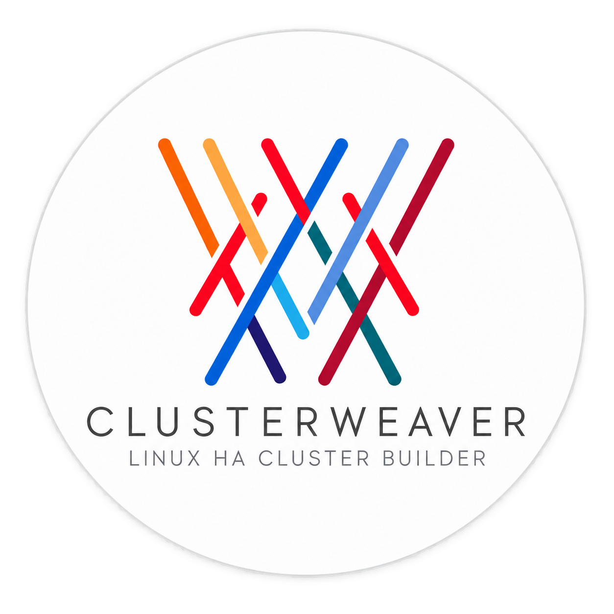

# ClusterWeaver

**English** | [Italiano](README_IT.md)

<p align="center">
  
</p>

[](LICENSE)

Linux High Availability Cluster Builder & Lifecycle Manager.

Current release: **0.1.12** (2026-10-09). Release history is maintained in `CHANGELOG.md` and is also available from the Changelog link in the web interface.

ClusterWeaver is free software licensed under the [GNU Affero General Public License v3.0](LICENSE). Modified versions offered to users over a network must make their corresponding source available under the same license. Contributions are welcome; see [CONTRIBUTING.md](CONTRIBUTING.md) and [SECURITY.md](SECURITY.md).

This first MVP manages RHEL 7, 9, and 10 cluster projects and nodes. It stores searchable state in SQLite, writes a human-readable YAML definition, versions project files in a local Git repository, and generates a reviewable pre-check script. RHEL 8 is deliberately unsupported.

Projects can be assigned to color-coded Project Groups with unique names and optional descriptions. Home presents collapsed group and ungrouped sections with project counters, while Project retains the complete searchable and sortable inventory, including Group as a column and filter.

The generated remote workflow is divided into two collapsible phases. **Pre-Cluster Configuration** (steps 00–04) performs SSH bootstrap and discovery, network configuration and verification, `/etc/hosts` management, and preliminary checks. Step 00 exposes review, copy, and full-screen views for all three operations; its RHEL 7.9 network action is strictly read-only and reports NetworkManager or legacy network-scripts ownership, while RHEL 9.8 and 10.2 retain guarded configuration support. **Cluster Base Installation and Configuration** installs and verifies the Pacemaker packages (step 05), enables `pcsd` and authenticates the nodes (step 06), then creates the named cluster and verifies membership, `WaitForAll`, and quorum (step 07). Each action is gated by the successful completion of the preceding steps and records its result per node.

## Development prerequisites

- RHEL 10.2 (canonical development/runtime environment)
- Python 3.12+
- Git
- `python3-pip`

On RHEL:

```bash
sudo dnf install git python3-pip
```

## Setup

For an automated RHEL installation, use the scripts documented in [`setup/README.md`](setup/README.md). They cover a fresh GitHub bootstrap, local-checkout installation, safe updates, database migration, systemd, optional firewalld configuration, and health verification.

**Offline installation is deprecated as of 0.1.12. This release does not publish offline installation bundles. The instructions below are retained for historical reference.**

For disconnected RHEL 10.2 x86_64 servers, [`setup/offline-container/README.md`](setup/offline-container/README.md) documents the Podman OCI bundle. The target uses only packages delivered by Satellite and the transferred archive; GitHub, PyPI, and external registries are not contacted during installation.

Manual development setup:

```bash
python3 -m venv .venv
source .venv/bin/activate
python -m pip install -r requirements.txt
```

Set a private session key outside source control:

```bash
export CLUSTERWEAVER_SECRET_KEY='replace-with-a-random-value'
export CLUSTERWEAVER_LOGIN_USERNAME='admin'
export CLUSTERWEAVER_LOGIN_PASSWORD='changeme' # first administrator bootstrap only
```

The checked-in default is suitable only for local development.

The first start creates the default administrator `admin` with password `changeme` when the users table is empty. Its first login is restricted to **Configuration**, password change, and logout until `changeme` is replaced. This protection also detects existing installations that still use the original credential. Bootstrap credentials are ignored after the first user exists; passwords are stored only as salted hashes in SQLite.

## Authentication, roles, and appearance

ClusterWeaver requires authentication for every project page. The Configuration page provides personal password and theme settings plus administrator-only account management.

- `user`: read-only access to projects, nodes, generated scripts, and execution results.
- `clusteradmin`: can create and manage clusters and execute remote workflows, but cannot create, edit, or delete users.
- `administrator`: unrestricted cluster and user management.

Each account records the time its password was last changed. The soft dark-grey interface is the default; users can select the light theme independently. The login form is vertically centred, and the transparent PNG logo adapts to both themes while retaining its white circular interior. Clicking the logo after login shows the ClusterWeaver version, author, GitHub project, and runtime component versions.

## Database initialization and migration

```bash
source .venv/bin/activate
alembic upgrade head
```

Production SQLite state is stored under `/var/lib/clusterweaver/data`; development uses `data/clusterweaver.db`. Databases are ignored by Git and are not the sole copy of project knowledge.

## Start the development server

```bash
source .venv/bin/activate
python run.py
```

Open `http://127.0.0.1:5000`. The development server listens on localhost only and is not a production deployment method.

To make the development server reachable from another machine on the same trusted network:

```bash
export CLUSTERWEAVER_HOST=0.0.0.0
python run.py
```

Then open `http://<vm-ip>:5000`. If `firewalld` is active, TCP port 5000 must also be allowed on the VM's active zone. Do not expose the Flask development server directly to an untrusted or public network.

## systemd service

The installed `clusterweaver-control.service` runs `/opt/clusterweaver/app` with its virtual environment at `/opt/clusterweaver/venv`. Gunicorn runs as the unprivileged `clusterweaver` account, starts at boot, stores state in `/var/lib/clusterweaver`, and reads private configuration from `/etc/clusterweaver/clusterweaver.env`.

To test changes from the local checkout against the native service without repeating a complete installation:

```bash
sudo ./setup/update-local.sh
```

This preserves project data and configuration, backs up SQLite, applies migrations, restarts and verifies the service, and rolls back application/database changes if verification fails. It rebuilds the virtual environment only when `requirements.txt` changes.

## Operating-system architecture

The recommended disconnected RHEL 10.2 deployment runs ClusterWeaver as a Podman container managed by systemd through Quadlet:

```text
Browser
   │ TCP/5000
   ▼
systemd → Podman → ClusterWeaver (Flask/Gunicorn)
                         │
                         ├── SQLite database
                         ├── YAML projects and local Git history
                         └── SSH TCP/22 → managed cluster nodes
```

The host layout is deliberately small:

```text
/etc/clusterweaver/clusterweaver.env             # protected configuration and secrets
/etc/containers/systemd/clusterweaver.container  # Podman Quadlet definition
/var/lib/clusterweaver/data/clusterweaver.db      # persistent SQLite database
/var/lib/clusterweaver/data/projects/             # persistent YAML projects and Git history
```

Application code and Python dependencies are stored inside the versioned OCI image, for example `localhost/clusterweaver:0.1.12`. The container runs as unprivileged UID `10001`, has a read-only application filesystem, drops all Linux capabilities, writes only to the mounted data directory, and provides a periodic health check. On the disconnected target, Satellite supplies only the required RHEL packages; the transferred bundle supplies the application image without contacting GitHub, PyPI, or an external registry.

It can be managed directly with systemd:

```bash
systemctl status clusterweaver-control
systemctl start clusterweaver-control
systemctl stop clusterweaver-control
systemctl restart clusterweaver-control
systemctl reload clusterweaver-control
journalctl -u clusterweaver-control -f
```

Use the convenience script:

```bash
./scripts/clusterweaver-control start
./scripts/clusterweaver-control stop
./scripts/clusterweaver-control restart
./scripts/clusterweaver-control reload
./scripts/clusterweaver-control status
./scripts/clusterweaver-control logs
```

`reload` applies Python/template changes gracefully. Static assets normally require only a browser refresh. After changing dependencies or the unit file, use `restart`.

## Run tests

```bash
source .venv/bin/activate
pytest
```

Tests use isolated temporary databases and project repositories; they do not contact or execute commands on cluster nodes.

## Runtime data

In production, each project is written to:

```text
/var/lib/clusterweaver/data/projects/<project-slug>/project.yaml
```

`data/projects/` is initialized as a separate local Git repository. Meaningful YAML changes create commits; SQLite databases, logs, and secret YAML files are ignored. Generated workflow scripts are displayed for review. SSH discovery and explicitly confirmed SSH key bootstrap actions are executed remotely from the project page; passwords are used only in memory and are never written to project data or logs.

## Portable projects

Each project can be exported from the Projects table as a portable `.cwp` archive and imported into another ClusterWeaver instance. Imports always create a new project with a new UUID and reset all remote execution state. The archive contains the editable project definition—including the independent Pacemaker cluster name—generated workflow scripts, format metadata, and SHA-256 checksums; it excludes passwords, SSH keys, application secrets, execution logs, and step results.

On disconnected installations, `.cwp` archives can also be placed in `/var/lib/clusterweaver/data/Project-Import` and selected through **Projects → Import project → Import from server**. The directory may be populated manually or used as the working tree of a separately managed private Git repository. ClusterWeaver never stores Git credentials or runs `git pull`; it only reads direct, regular `.cwp` files and applies the normal archive checksum and schema validation.

Small application changes can be transported to an offline Podman installation as checksum-protected `.cwu` packages. They update a read-only application mount with database backup, health verification, and automatic rollback; a complete OCI bundle is required only for dependency or base-image changes. See `setup/offline-container/README.md`.

Configuration can be overridden with:

- `CLUSTERWEAVER_SECRET_KEY`
- `CLUSTERWEAVER_LOGIN_USERNAME` (initial administrator bootstrap; defaults to `admin`)
- `CLUSTERWEAVER_LOGIN_PASSWORD` (initial administrator bootstrap; defaults to `changeme`, is stored as a password hash, and is ignored after the first user exists)
- `CLUSTERWEAVER_DATABASE_URL`
- `CLUSTERWEAVER_PROJECTS_ROOT`
- `CLUSTERWEAVER_HOST` (defaults to `127.0.0.1`)
- `CLUSTERWEAVER_PORT` (defaults to `5000`)
- `CLUSTERWEAVER_DEBUG` (defaults to disabled)
- `CLUSTERWEAVER_SSH_BOOTSTRAP_PASSWORD` (optional initial root password stored only in the protected service environment file)

## Directory layout

```text
clusterweaver/
├── core/          # framework-independent models, validation, generators, serializers, services
├── persistence/   # SQLAlchemy records and repositories
├── web/           # Flask application, routes, forms, templates, static assets
└── cli/           # reserved for the future CLI
cluster_templates/ # isolated RHEL 7, 9, and 10 templates
data/              # SQLite state and Git-versioned project definitions
migrations/        # Alembic schema history
tests/             # unit and web integration tests
```

The MVP currently excludes Pacemaker resource configuration, storage provisioning, STONITH creation, Ansible integration, and RHEL 8 support. Remote SSH operations are gated by workflow prerequisites and explicit confirmation where they modify node state.

## Step 08a: DELL OEM profiles

The **Cluster STONITH Configuration and Testing** workflow currently includes only **08a**. Define the DELL OpenManage Enterprise endpoint (hostname or IP, HTTPS/443), then the exact OEM profile name and userid for each node. Verification passwords remain request-scoped and are excluded from SQLite, YAML, Git and portable `.cwp` archives.

**Save profiles** persists definitions. **Save and verify OEM profiles** sends read-only HTTPS GET requests from the ClusterWeaver server to DeviceService and ProfileService, with a TemplateService fallback for older appliances. Checks report missing names, case mismatches, incorrect or unverifiable device assignments, and disconnected devices. Returned status values are displayed; successful lookup does not certify profile health or fencing capability. Requests have an 8-second timeout and share a 45-second verification budget. Definition changes invalidate earlier 08a results.

Trust the OEM TLS certificate on the server, or set `CLUSTERWEAVER_OEM_CA_FILE` to a PEM CA file readable by the service. Apply migration `0016_stonith_ipmi` before starting this version (`alembic upgrade head`). The displayed standalone Python script uses the same read-only adapter and prompts for passwords. Step 08a does not create STONITH resources or perform power actions.

API references: [Dell profiles](https://www.dell.com/support/manuals/en-uk/dell-openmanage-enterprise/ome_p_38_api_guide/profiles?guid=guid-044ccf90-224f-4efa-9d91-43c91178eb0d&lang=en-us), [Dell authentication](https://www.dell.com/support/manuals/en-us/dell-openmanage-enterprise/ome_p_3.10_api_guide/authentication?guid=guid-12bfee52-90ef-4ef0-b37c-f7071363fb11).

The **DELL iDRAC / IPMI diretto** option collects each node hostname, iDRAC host/IP, future STONITH resource name, userid and password. Install RHEL `fence-agents-ipmilan` on the ClusterWeaver server (or in its container image). Verification runs `fence_ipmilan` with LANPlus and `action=status`, reading ON/OFF only, with a 20-second per-node timeout and 45-second total budget. It does not verify the physical controller-to-host association or perform fencing. Passwords are never saved. Existing OEM configurations retain their mode after migration.

Step 08a also provides **Check fence agents on cluster nodes**, a separate read-only SSH check requiring saved profiles and the root SSH password (or configured server password). Each node is accessed through its configured SSH IP. The check lists fence-agent RPMs and `fence_*` executables; IPMI additionally requires `fence_ipmilan` and reads its metadata with a 10-second timeout. Remote commands have a 20-second limit within a shared 45-second budget. OEM currently performs inventory only, since no OEM Pacemaker agent is selected. Results are stored separately from controller tests and invalidated after profile or node identity/SSH endpoint changes.

Missing agents produce the manual root command `dnf install fence-agents-all` for affected nodes; the RHEL High Availability repository must be available through Satellite/subscription. No automatic installation takes place. A working required individual agent passes even without the all-agents metapackage. SSH errors are distinguished from missing agents.

## Persistent project SSH access

Step 00 includes **ClusterWeaver SSH key**, available even on older projects without repeating completed workflow steps. The local service uses the existing `clusterweaver` account (UID 10001 in containers), and connects as root on the nodes.

Configure node SSH IPs, enter the application source IP as seen by the nodes (including NAT), and supply current root passwords, shared or per node. Confirm **Install / resume and verify project key**. The server generates a project-specific RSA 3072-bit key, adds only its public key, records node host identities and verifies a fresh key-only root connection. The key becomes active only after all current nodes pass; incomplete installations reuse the same pending key. Existing authorized keys and node-to-node trust remain intact. `CLUSTERWEAVER_SSH_SOURCE_IP` can prefill the source IP.

Leave workflow password fields empty to use the active key for discovery, peer trust, network configuration, steps 01–07 and step 08a node-agent checks, irrespective of an obsolete configured password. An explicitly supplied password requests temporary password authentication. Failed key authentication never automatically falls back to passwords. Daily root password changes do not modify the authorized public key, provided SSH/PAM policies still permit access. Controller and hacluster credentials remain separate.

Service-owned credentials live in `<PROJECTS_ROOT parent>/ssh_keys/<project UUID>/`, normally `/var/lib/clusterweaver/data/ssh_keys/<UUID>/`. Override with `CLUSTERWEAVER_SSH_KEYS_ROOT` outside the projects Git tree; containers require a persistent writable mount owned by UID 10001. Directories use 0700; private keys and known_hosts use 0600. Keys are excluded from YAML/Git/portable exports, and imported projects receive a new UUID and require new enrollment. Back up this directory separately with restricted access: database backups do not include keys. Deleting a project does not automatically revoke keys from its former nodes.

Public-key entries use `from="source IP",restrict`, allowing noninteractive root commands. Host identities are enrolled during password provisioning; subsequent key sessions reject unknown or changed identities. Manually verify fingerprints before updating known_hosts after node reinstallations. Network step 00c requires the original node host key on the new management IP before cancelling rollback.

**Verify key-only access** is read-only. **Rotate project key** retains the active key until all nodes accept its replacement. **Revoke previous key** removes only the old public key using the new active key, then deletes the previous local private key only after every current node succeeds. Removed nodes require manual revocation. A new rotation is blocked while a previous key awaits revocation. Operations run in parallel within a 90-second budget with 20-second remote command limits and per-node results; timed-out operations may have partially updated public keys and can be resumed. No additional database migration is required.

## Cluster Operations and Status

**Gestisci cluster** links to a collapsible operations section after the project configuration and STONITH workflows. It provides cluster/quorum/online summaries, per-node services and boot configuration, resources/failures, guarded scripts, progress and persisted user/time/command/result history. Controls require an active project SSH key and successful 00k key-only verification on every current node, independent of old installation workflow history. Read-only users can refresh and inspect status; modifying operations require administrator/clusteradmin and explicit confirmation.

Read-only snapshots use Corosync configuration, systemd, crm_mon XML and full pcs status. Start/stop and boot enable/disable are local pcs commands on every configured SSH IP; stop never forces shutdown. Boot controls do not start/stop services. Standby/unstandby use the Pacemaker nodename and run once on a coordinator with quorum. Standby rejects the last available resource host, missing quorum and unresolved failures, and waits for resources to leave the node. Unstandby permits placement without forcing resources to return. Preflight verifies all SSH keys and exact cluster/node identities before sending any mutation. Already compliant states skip commands. PASS certifies the requested operation/status collection, not overall resource health.

Jobs run in web-worker background threads; HTTP returns immediately and the browser polls persisted progress every two seconds. A database-unique project reservation prevents duplicate jobs across workers. Inventory/key edits and conflicting legacy mutations are blocked while a job is running. Mutation command limit: 120 seconds; start/stop state verification: 180 seconds; other verification: 60 seconds; total budget: 360 seconds, with commands reduced to remaining time. Command timeout or lost transport produces UNKNOWN and a new read-only snapshot, never an automatic mutation retry. A successful status refresh is required before further mutations. Worker restart interrupts a job: after 600 seconds its reservation is released as UNKNOWN, without replay. History is excluded from portable projects. Apply migration `0017_cluster_operations` with `alembic upgrade head` before starting this version.
